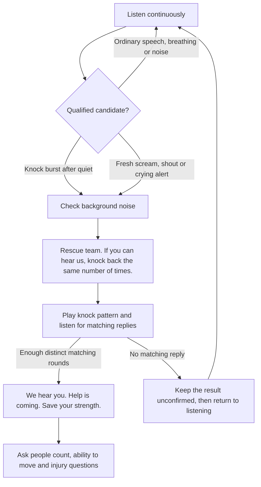

# Automatic listen-and-respond on the Pi

`hb run --auto --profile clap-distress` now connects fresh vocal distress alerts
to the same deterministic knock-response dialog used for spontaneous knocks.
This is stationary sentinel behavior; it does not open a rover connection or
issue movement commands. Connect and validate the rover movement path later.

## What it says and when



The engine may delay a challenge or ask for quiet when the background is too
noisy. It chooses later knock counts deterministically from a seeded sequence,
requires distinct matching rounds, and computes its existing match statistics.
A scream, class score or ASR transcript never counts as a knock reply and never
sets `CONFIRMED`. ASR help phrases trigger a check only if ASR is enabled in
the monitor profile; it is disabled by default.

The existing interview prompts are:

- "Knock once for each person with you."
- "Can you move? Knock two times for yes. One time for no."
- "Are you hurt? Knock two times for yes. One time for no."

The classifier's relative scores and dialog match statistics are not a
calibrated probability that a person is present. Real detection accuracy still
needs measurement with the actual microphone and environment.

## Start it on hardware (human-operated)

First use a working, verified audio output. The currently tested Grove speaker
still produces distorted tones; this software change does not fix its analog
input, PWM reconstruction or electrical levels. Do not treat an output-device
check or a completed playback command as proof of intelligible speech.

From `~/Team-14`, start the existing CPU-only CLAP service in terminal 1:

```bash
bash scripts/clap_pi.sh
```

Wait for `CLAP ready`. Add `--allow-download` only if weights are not cached.
The wrapper uses `profiles/clap-distress.yaml`; the listener below must use the
same profile. See [PI-CLAP-LOCAL.md](PI-CLAP-LOCAL.md) for service setup.

In terminal 2, list the audio devices:

```bash
uv run hb devices
```

Replace `OUTPUT_INDEX` below with the selected output index. For an M5Stick
microphone bridge use `--device stick` (or `stick:/dev/ACTUAL_MIC_PORT`). For a
USB microphone replace `stick` with its input index. Run only one listener on
that input.

```bash
uv run hb run --profile clap-distress --auto \
  --device stick --knocker speaker --speaker-device OUTPUT_INDEX --dashboard
```

`--knocker speaker` plays both spoken prompts and the challenge knock WAVs on
the selected audio output. It does not scan serial ports for a physical
knocker. A physical knocker can later be selected explicitly by its port.

`--auto` enables automatic challenges and the interview. Without that flag the
profile's default manual challenge behavior remains available. Keyboard
commands followed by Enter include `c` challenge, `r` reset and `q` quit.
The dashboard also exposes the existing operator commands.

## Timing, logging and failure behavior

- `dialog` in `profiles/rubble.yaml` controls the knock burst, quiet/background
  check, challenge rounds, answer windows and retry/cooldown rules.
- `classifier.clap.monitor` in `profiles/clap-distress.yaml` controls continuous
  vocal windows, threshold and alert cooldown. The responder also rejects
  results older than `classifier.clap.max_lag_s`.
- Entire vocal windows must be newer than the last reset and the previous
  prompt's gate tail. Queued observations are checked again at an audio block
  boundary; reset, an active challenge or shutdown can discard them.
- Own prompts are gated out of both knock answers and vocal responses.
  Repeated vocal alerts cannot restart an active challenge. The configured
  monitor cooldown also bounds subsequent responses after a reset.
- `audio_observation`, `prompt_start`, `prompt_end`, `round_result`, `answer`
  and state events remain in the black box. An `operator` event with
  `action: distress_challenge` records why an automatic vocal check started.
- Existing speaker failures are logged and voice can be disabled while the
  rest of the session continues. Observe the error events: a running session
  does not guarantee audible speech.

`hb listen` still only observes audio. `hb patrol` retains its existing
STOP/settle/fresh-verification controller and disables the stationary automatic
challenge policy, so this change cannot bypass the patrol motion interlock.
No motor firmware or route behavior changed in this task.

## Verification

The tests exercise automatic knock and scream candidates through the real
sample-clock dialog and a fake speaker/survivor. They verify challenge speech,
matched-reply reassurance and interview, no confirmation for a scream without
answers, ordinary-label rejection, stale/reset/own-prompt gating, cooldown and
the existing patrol tests. No physical device, network or model is required.

```bash
uv run pytest -q tests/test_voice_response.py tests/test_patrol_audio.py tests/test_audio_monitor.py
uv run pytest -q
```

Physical speech audibility, acoustic classifier accuracy and integrated rover
movement remain unverified by these software tests.

Validation on 2026-11-08: the full `uv run pytest -q` suite passed **826 tests**,
with one existing Starlette/httpx deprecation warning.
